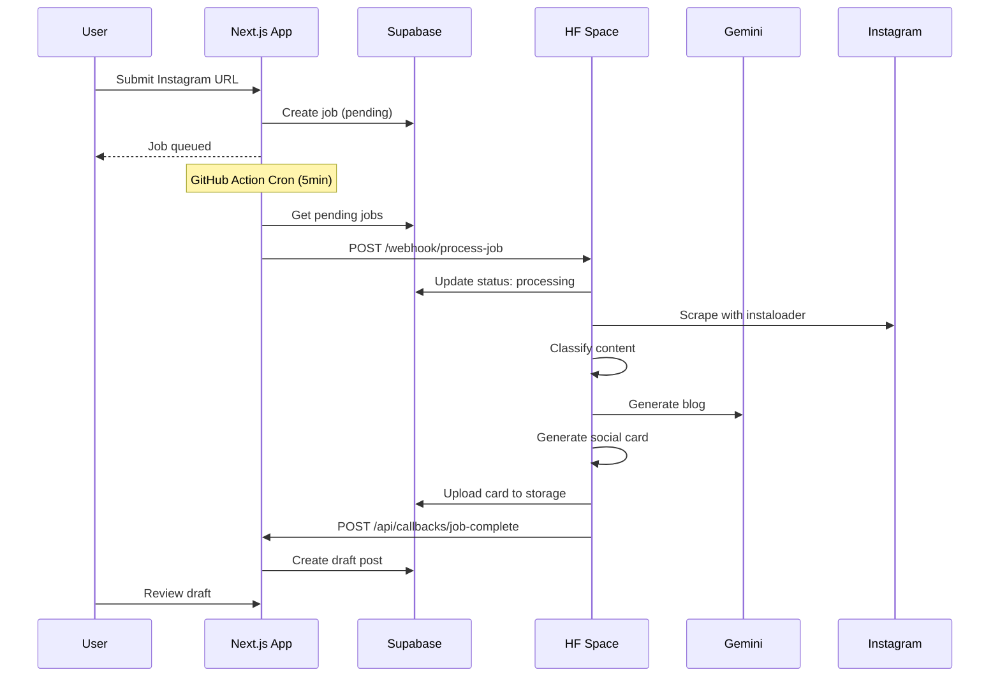

# Instagram Blog Processor - Architecture

## Overview

Two-tier architecture separating concerns:
- **Next.js App (Vercel)**: User interface, authentication, job queue management
- **HuggingFace Space (Python/Docker)**: AI processing, scraping, content generation

## System Flow

## Component Responsibilities

### Next.js App

**Admin UI**
- URL submission form
- Job queue dashboard
- Draft review interface
- Affiliate link finalization

**API Routes**
- POST /api/jobs/create - Create new job
- GET /api/jobs/list - List jobs
- POST /api/cron/trigger-hf-space - Trigger HF Space (GitHub Actions)
- POST /api/callbacks/job-complete - Receive results from HF Space

**Database**
- Job queue management
- Draft post creation
- Status tracking

### HuggingFace Space

**FastAPI Service**
- POST /webhook/process-job - Receive job from Next.js
- GET /health - Health check

**Processing Pipeline**
1. Instagram scraping (instaloader)
2. Content classification (transformers)
3. Blog generation (Gemini API)
4. Affiliate detection
5. YouTube embedding
6. Social card generation (Pillow)
7. Supabase upload
8. Callback to Next.js

## Technology Stack

### Next.js App
- TypeScript
- Next.js 14
- Supabase client
- TailwindCSS

### HuggingFace Space
- Python 3.11
- FastAPI
- Instaloader (Instagram scraping)
- Google Gemini API (content generation)
- Pillow (image generation)
- Transformers (classification)
- Supabase Python SDK
- Docker

## Deployment

### HuggingFace Space
1. Connect GitHub repo to HF Space
2. Choose Docker runtime with GPU (basic)
3. Add secrets in Space settings
4. Auto-deploys on git push

### GitHub Actions
- Public repo = unlimited cron jobs
- Runs every 5 minutes
- Checks for pending jobs
- Triggers HF Space webhooks

## Security

**Webhook Authentication**
- X-Webhook-Secret header
- Validated by HF Space

**Callback Authentication**
- HMAC signature
- Validated by Next.js

**Secrets Management**
- HF Space: Environment variables in Space settings
- Next.js: Vercel environment variables
- GitHub Actions: Repository secrets

## Scalability

**Current (Free Tier)**
- 1 HF Space instance (GPU basic)
- Process ~20 posts/hour (Gemini rate limit)
- GitHub Actions unlimited cron

**Future (Paid)**
- Multiple HF Space instances
- Higher Gemini quota
- Parallel processing
